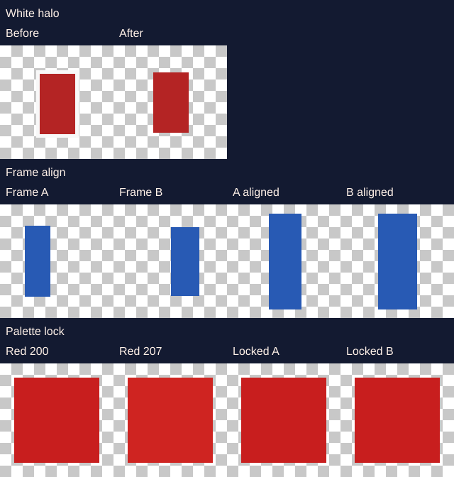

# Generation and animation quality — findings

Investigation only. Production models, prices, credits, billing, auth and stored data are unchanged. The extra post-process is behind `SPRITE_QUALITY_POSTPROCESS=1` and does nothing when that variable is unset.

This run did **not** call Runware, Cloudflare or Anthropic. `RUNWARE_API_KEY` is not set in this environment and `.env.local` is absent. Anything about real model output below is a reading of the code or of the committed cost table, not a new generation.

## What was measured here

Synthetic fixtures only (`npx tsx scripts/quality-benchmark/run.ts`). Numbers are in `outputs/metrics.json`.

| Fixture | Before | After the quality pass |
| --- | --- | --- |
| White halo on a red rectangle | 120 light-fringe edge pixels, centre offset 1px | 0 fringe pixels, offset 0 |
| Two frames, different canvas and a 4px height drift | foot line differs by 6px, heights differ by 4px, canvases differ | same canvas, foot line delta 0, height delta 0 |
| Two reds, (200,30,30) and (207,36,33) | 2 opaque colours | 1 colour |
| Crouch vs standing figure | crouch height / stand height = 0.389 | same ratio, 0.389 (crouch was not scaled up) |



The palette row looks almost identical on purpose: the lock only merges colours within a distance of 12, which is a speckle, not a shading step. A shading pair at distance ~33 stayed two colours in the unit test.

These fixtures are drawn in code. They do not say that production sprites have a 120-pixel halo, or that the pass will look better on FLUX.2 output. That comparison needs `--live`.

## How to run the harness

Offline, no spend:

```bash
npx tsx scripts/quality-benchmark/run.ts
```

Writes `docs/quality-investigation/outputs/offline-contact-sheet.png` and `metrics.json`.

Live, hard cap **$3** of list price, reserved before each call. The script talks to Runware directly. It does not charge credits, open a billing operation, or write `provider_calls` / `generation_events`.

```bash
npx tsx --env-file=.env.local scripts/quality-benchmark/run.ts --live
npx tsx --env-file=.env.local scripts/quality-benchmark/run.ts --live --hd
npx tsx --env-file=.env.local scripts/quality-benchmark/run.ts --live --animate
```

`--hd` adds one GPT Image Mini still (list $0.036). `--animate` adds one 1024 Nano Banana grid (list $0.0692) and only if the klein knight file from the same run exists. `--extra-model <air> --extra-usd <list price>` is one extra still and is refused when the list price is missing or would cross the cap. The cap cannot be set above 3.

Default live set, if you run it: five stills on `runware:400@2` (the production standard model) plus one strict-prompt redraw of the pixel knight at the same seed. Prompt text is `buildSpritePrompt` (production) vs `strictPrompt` (harness only). The Haiku subject interpreter is **not** called, so a live run does not match the full production prompt and does not spend Claude.

Do not use `scripts/sprite-bench.ts` for this. Its default model list is klein + Nano Banana + Seedream + GPT Image Mini for four subjects, and it post-processes pixel art at grid 64. Production uses grid 128. A full default run of that older script can pass $3.

Unit tests: `src/lib/image/quality-postprocess.test.ts`, `src/lib/quality-benchmark/offline.test.ts`.

## Pipeline map

Canonical stills go through `/api/generate` → `generateAssets` → `generateSingle2D`. The comment at the top of `generation.ts` that says the service is not wired is stale.

| Operation | Route | Provider / model | What the prompt is | Post-process | Credits | Failure |
| --- | --- | --- | --- | --- | --- | --- |
| Still, draft or normal, any style including pixel, realistic, character, creature, item | `POST /api/generate` | Runware `runware:400@2` FLUX.2 klein, 1024² PNG. List $0.0008 (measured n=94 in `FEATURE_COSTS`) | Haiku `claude-haiku-4-5-20251001` rewrites the subject (`interpretSubject`, 8s, no retry, falls back to the raw text). Then `buildSpritePrompt`: one subject, style line, margin, flat white key (magenta for pale pixel subjects). No negative prompt. Cut at 2900 characters | `postprocessSprite`: flood-fill key, crop, centre, pixel grid up to 128 with the model's own pixel size when it is close, k-means 32 colours, nearest integer upscale. Painted styles also key flat enclosed gaps. Tiles use `postprocessTile` (seamless, no keying) | 1 | One retry on the standard model if time remains. Runware down → Cloudflare FLUX.2 klein **4B** (`@cf/black-forest-labs/flux-2-klein-4b`), prompt cut at 2000 characters, cost recorded as $0. Daily allowance exhausted → 503, no charge. Provider failure after charge → `op.fail` refunds |
| Still, HD | same | Runware `openai:1@2` GPT Image Mini. List $0.036 (measured n=31). Seed is **not** sent (only klein accepts it) | same prompt | same | 3, dropped to 1 if the HD model did not actually draw it | Same retry, but the retry is klein, and the extra credits are refunded |
| Style match | same, with `styleReferenceId` | Runware `google:4@3` Nano Banana, 1024, reference image. List $0.0692, derived, n=0. Worst case two passes | sprite prompt plus "match this style, draw a new subject" | same, pixel grid taken from the reference when it is ≥ 24 | 5 | On failure, falls through to the selected style on klein and refunds the difference |
| Guest demo | `POST /api/generate-guest` | klein only | `interpretSubject` + `buildSpritePrompt`. Pixel or cartoon | `postprocessSprite` only. No Runware background-removal fallback | 0 | No charge. Post-process errors keep the raw image |
| Animate 4 / 6 / 9, optional smooth | `POST /api/animate` | Planner: Claude `claude-opus-5-5` (45s). Frames: Nano Banana `google:4@3`, 1024 for 4 frames, 2048 for 6 and 9. In-betweens are a second grid | `planAnimation` writes a pose per frame. `buildAnimationPrompt` / `buildInbetweenPrompt` | `extractFrames` keys white, splits on gutters. `assembleAnimation` aligns feet (or air / cell / centre), shifts upper bodies horizontally, pulls colour stats 85% toward the median, then resamples. Pixel frames go through a Mitchell downscale, one shared 32-colour palette, nearest upscale | 7 / 11 / 12, plus 5 or 7 when smooth | Bad layout: one redraw if time and the per-operation cap allow. A thrown first attempt is not retried. Smooth that doesn't line up keeps the keys and does not fail the request. Route refunds on throw |
| 4- and 8-direction, 4-direction walk | same route, rotation actions | Nano Banana, one sheet. Walk may redraw a frozen row at 1024 (list $0.0692 each) | `buildRotationPrompt` / `buildWalkSetPrompt` / `buildWalkRowPrompt`. Left walk row is a mirror of right | `assembleAnimation` with `alignBodies: false`. Walk sheet is re-packed to one row per direction | 6 / 10 / 12 | Broken or sliced views throw and the route refunds. Frozen rows are kept if the redraw is worse or the cap/time runs out |
| Idle / breathe / hover, pixel walk of a biped | same | No image model. Joints: Claude (rig cost is the Claude estimate). Cut-out of the original sprite | n/a | `makeSkeletonIdle` / `makeRigAnimation` / `makeItemMotion` / `makeSkeletonAnimation` | 3 (`RIG_CREDITS`) | Falls back from skeleton to a simple rig. Route refunds on throw |
| Tile animation | same, tileset source | Nano Banana, no planner | `buildTileAnimationPrompt` | `assembleTileAnimation`: cover-resize with Mitchell, shared palette if pixel, nearest up to 256. No background key | tile feature, one grid | No redraw loop |
| Edit | `POST /api/edit-image` → `editSprite` | Nano Banana 1024. List $0.0692 derived, n=0 | Short edit instruction, white background. Masked edits restore unmasked pixels from the original | `postprocessSprite`, pixel grid copied from the source | 5 | Paid operation, refund on failure (same pattern as the other tool routes) |
| Remove background | `POST /api/remove-bg` | Runware `removeBackground`, 20s timeout, no retry. List reservation $0.002, estimate, n=0 | n/a | Result is re-hosted. Not run through `postprocessSprite` | 1 | Refund if the provider fails or the re-host fails. Starter and above |
| AI upscale 2× / 4× | `POST /api/upscale` | Runware upscale. Reservation $0.01, estimate, n=0 | n/a | none | 1 or 2 | Refund before the file is stored |
| Pixel-perfect upscale | same, `modelType: "pixel"` | local nearest-neighbour | n/a | integer scale, cap 4096 | 0 | No charge |
| Variations | `POST /api/variations` | Replicate `black-forest-labs/flux-1.1-pro`. List $0.04, estimate, n=0 | img2img | re-host | 3 each, up to 4 | Paid operation |
| 3D | `/api/generate-3d`, `/api/generate-3d-stream`, queue worker | Replicate (Rodin / others) plus a FLUX reference image. Not the 2D sprite pipeline | legacy `buildUltimatePrompt` **does** send a negative prompt, on FLUX.1 via `generateImage` | background removal on the reference in the queue worker | feature `model_3d` | Separate from 2D. Queue worker refuses to run without `QUEUE_SECRET` |

Legacy `RUNWARE_MODELS` (`flux-schnell` `runware:100@1` ~$0.003, `flux-dev` `runware:101@1` ~$0.01, `flux-pro` `bfl:2@1` ~$0.03) are the old tier map. The live still path does not use them. They are all more expensive than klein. There is no cheaper production AIR id in the repo.

Negative prompts exist in `src/config/prompts/negative-prompts.ts` and are assembled by `buildUltimatePrompt` for the queue / 3D reference path. `generateSpriteImage` and `generateAnimationGrid` send `positivePrompt` only. That is intentional in the sprite-prompt comment: these models are instructed in prose, and a fake "transparent background" makes them paint a checkerboard. Adding a negative prompt to the klein call is not a drop-in fix.

## Quality and reliability issues in the code

1. **Keying gives up on a non-flat border, and the user can still be charged.** `keyOutBackground` returns false when under half the border matches one colour, and leaves the pixels. Signed-in generation then calls Runware background removal once, with a 20 second timeout and no retry. If that fails, the warning is "We couldn't separate the background" and the credits stand. The guest path never makes that call, and it does not look at `backgroundRemoved`.

2. **A thrown post-process is swallowed.** `generateSingle2D` catches it, stores the raw provider PNG, adds a warning, and charges. Tile post-process does the same with no warning. The product rule is to not charge for an output the user didn't get. A raw image with a background is an output, but it is not the sprite the pipeline claims to always produce.

3. **Upload failure refunds; a database save failure does not.** Upload runs inside `op.run`, so a failed upload refunds even though the provider was paid. That matches "don't charge for an image the user didn't get". The file header in `generation.ts` still says not to refund after provider success; that comment is wrong for the upload step. If R2 succeeded and `saveGeneration` failed, the code logs a recovery note and still calls `op.succeed`. There is no job that puts the row back. The user paid and may not see the sprite in the gallery.

4. **Pixel canvases are not one size.** `postprocessSprite` keeps the model's detected pixel size when the native side is between 0.8× and 1.3× of the target, and grows or shrinks `canvasSize` to fit. The comment in that function says a set of sprites must share one pixel size, and also says forcing 64 merged faces into blobs. Both are in the code. The new pass does not resample stills, so it does not resolve this.

5. **Animation colour lock is partial.** `matchColours` moves each frame 85% of the way to the median mean and spread, and it no-ops when frame buffers differ in length. It is not a shared palette. Pixel assembly does quantize to one palette, but only after a Mitchell downscale, which is a blur kernel. Tile assembly uses Mitchell too. Thin outlines can shift a pixel between frames after that resample. This is a code path, not a measured flicker rate.

6. **Body alignment does not fix scale, and direction sheets skip it.** `alignBodies` only shifts x so the upper body overlaps frame 0. Feet are the bottom of each cropped frame, so a taller drawing still has a higher head. `makeRotation` passes `alignBodies: false` because a side view and a front view should not be forced to overlap. Small scale drift between those views is then left as-is, except when a frozen walk row is redrawn and scaled back to the row's median height.

7. **Walk and key-frame retries are layout retries, not transport retries.** A timeout or a dropped connection on the first grid throws. The moderation retry (rephrase as cartoon game art) is the only automatic second call for a flagged grid. A second draw happens when the frames look wrong, and only if `canSpend` and the time budget allow. When in-betweens don't line up, `makeAnimation` returns the key frames with `smoothed: false`. The route then refunds the smooth extra (`op.refund(credits - option.credits, "smooth_pass_unavailable")`) and reports `creditsUsed` as the key-frame price. The charge is corrected. The user still receives a shorter animation than they asked for, with no second provider attempt after that refund.

8. **HD is not reproducible.** Seed is attached only when `model === "standard"`.

9. **Cloudflare fallback is a different model.** Klein 9B in, klein 4B out, shorter prompt, and HD is billed as a normal still because the returned model id is not `openai:1@2`. Quality of that fallback was not measured here. The free allowance is shared; the harness does not call it.

10. **Edit-route dead code.** `src/app/api/edit-image/route.ts` still contains an unused Runware img2img editor and `buildNegativePrompt` (eslint already flags them unused). The live function is `editSprite`.

## Cost, from the committed table

Not a new invoice. `src/config/provider-costs.ts` plus `costGbp` / `netPerCreditGbp` in `src/config/economics.ts`, computed in this session. Central cost includes the 15% failure overhead. Pro is $12 / 500 credits, net about £0.0168 per credit before VAT. Starter is $5 / 250 credits, net about £0.0135 per credit.

| Feature | Credits | Provider (status) | Central cost | Pro margin | Starter central margin | Starter worst-case margin |
| --- | --- | --- | --- | --- | --- | --- |
| sprite | 1 | $0.0008 + Claude $0.0014, measured n=94 | £0.0018 | £0.0151 | £0.0118 | £0.0108 |
| sprite HD | 3 | $0.036 + $0.0014, measured n=31 | £0.0324 | £0.0180 | £0.0082 | £0.0032 |
| style match / edit | 5 | $0.0692, derived n=0, max two passes | £0.0603 | £0.0238 | £0.0075 | **−£0.0685** |
| anim 4 | 7 | $0.0692 measured n=3 + Claude $0.035 | £0.0868 | £0.0310 | £0.0081 | **−£0.0793** |
| anim 4 smooth | 12 | $0.1419 measured n=20 + $0.035 | £0.1501 | £0.0518 | £0.0125 | **−£0.0796** |
| anim 6 | 11 | $0.1186 measured n=13 + $0.035 | £0.1298 | £0.0552 | £0.0193 | **−£0.0914** |
| 4-direction walk | 12 | $0.1375 derived (n=2), max $0.344 | £0.1197 | £0.0821 | £0.0429 | **−£0.1762** |
| remove bg | 1 | $0.002 estimate n=0 | £0.0017 | £0.0151 | positive | positive |
| AI upscale 2× | 1 | $0.01 estimate n=0 | £0.0087 | £0.0081 | thin | thin |

`KNOWN_MARGIN_VIOLATIONS` already lists style match, edit, anim 4, smooth 4, anim 6 and variations on Starter (some with VAT, some without). Prices were left frozen on purpose. Nothing in this branch changes them.

A still on klein is not where the money or the reliability risk sits. One Nano Banana pass costs about as much as 80 klein stills. HD is 45× the image cost of klein for 3× the credits, and on these figures it still clears Pro and barely clears Starter. Whether those extra credits buy better pixel art was **not** measured in this run.

There is no cheaper in-repo model to A/B against klein. Schnell, dev and pro are all listed above $0.0008. Testing Seedream or another AIR id belongs in `--extra-model` with an explicit list price, under the $3 cap.

## What landed

`src/lib/image/quality-postprocess.ts`

- `cleanupAlpha` — drops alpha under 16, then removes a white or magenta rim that is connected to transparency and within 4 pixels of a non-matte body. An opaque white ghost is kept (no non-matte body). A white fill behind a dark outline is kept (the outline blocks the outside flood).
- `recenter` — whole-pixel shift onto the same canvas. No resample. A subject that already spans the canvas is not moved.
- `lockPalette` — one greedy palette for a set of frames. Colours within distance 12 snap to the more common one. A real shading step further away stays.
- `alignFrames` — one canvas, shared foot line, upper-body x. A frame is nearest-neighbour scaled only when its height is within 12% of the median. A crouch stays short.

Wired in three places, each a no-op unless `SPRITE_QUALITY_POSTPROCESS=1`:

- signed-in stills, after the existing post-process, not for tiles
- guest stills, after the existing post-process
- `assembleAnimation`, after the existing align and colour match

Default behaviour returns the same buffer or the same frame array. The unit test checks the reference equality.

The strict prompt lives only in `src/lib/quality-benchmark/cases.ts`. It is not used by `/api/generate`.

## Ranked recommendations

1. **Run the live harness before changing prompts or models.** Five klein stills plus one strict redraw is about $0.005 at list price. Add `--hd` ($0.036) and `--animate` ($0.0692) only if you want those two comparisons. Judge the contact sheet. Do not ship `strictPrompt` on the strength of the extra sentences alone.

2. **Leave klein as the standard still model.** It is already the cheap one, the margin on a still is wide, and no cheaper AIR id is configured. Spend the next quality budget on animation, not on a different still checkpoint.

3. **Keep `SPRITE_QUALITY_POSTPROCESS` off in production until step 1.** The synthetic pass does what it claims on constructed halos, drift and near-duplicate reds, and it refuses to scale a crouch. That is the evidence we have. It is not evidence about real FLUX output, and a bad fringe rule on real silver armour would be worse than the halo.

4. **Treat animation as the quality and margin problem.** In code: Mitchell resample before the palette snap, 85% colour match instead of a hard palette, no scale normalization except the ±12% pass behind the flag, and direction sheets with body alignment off. A discarded smooth pass is refunded down to the key-frame price, so that part is not a silent overcharge. The Starter worst-case rows above are already known losses if a request hits the max pass count. Measure a walk sheet with `--animate` before rewriting prompts.

5. **Decide the failed-key policy explicitly.** When both the flood fill and Runware background removal fail, either refund or retry once. Today the user is charged and warned. Same for a thrown post-process that stores the raw PNG. Guest generations should at least surface `backgroundRemoved`, and they currently have no AI removal fallback. This branch does not change that, because it changes what the user is charged.

6. **Do not force every pixel sprite onto a smaller grid.** The code already records that grid 64 blobbed faces. Consistent scale across a game is unsolved; the safe version is the integer recentre, which is what the flag does.

7. **Pass the seed through for HD, or tell the UI that HD is not reproducible.** One line in `generateSpriteImageRunware`. Not done here.

8. **Repair gallery rows when R2 succeeded and the insert failed.** The log line is the only recovery. Separate from quality, but it is a "user paid and got nothing visible" path.

## Verification in this environment

- `npx vitest run` — 544 tests, 68 files, passed. Includes the new quality tests.
- `npx tsc --noEmit` — exit 0.
- `npx eslint` on the files this branch adds or edits — exit 0.
- `npx eslint .` — exit 1, 37 errors and 33 warnings, all in files this branch does not change (register page, pricing client, SpritePlayground, WelcomeEmail, and others).
- `npm run build` — exit 0 (Next.js 16.2.11, webpack). Node on this machine is 22.23.4; `package.json` engines asks for 24.x. The build printed `Failed to find font override values for font Atkinson Hyperlegible Next` and, while prerendering, `DATABASE_URL` was unset so community/featured queries logged a Prisma error and were caught. Static generation still finished 186/186.
- Live provider benchmark — not run. No images from FLUX, GPT Image, or Nano Banana were produced here.
